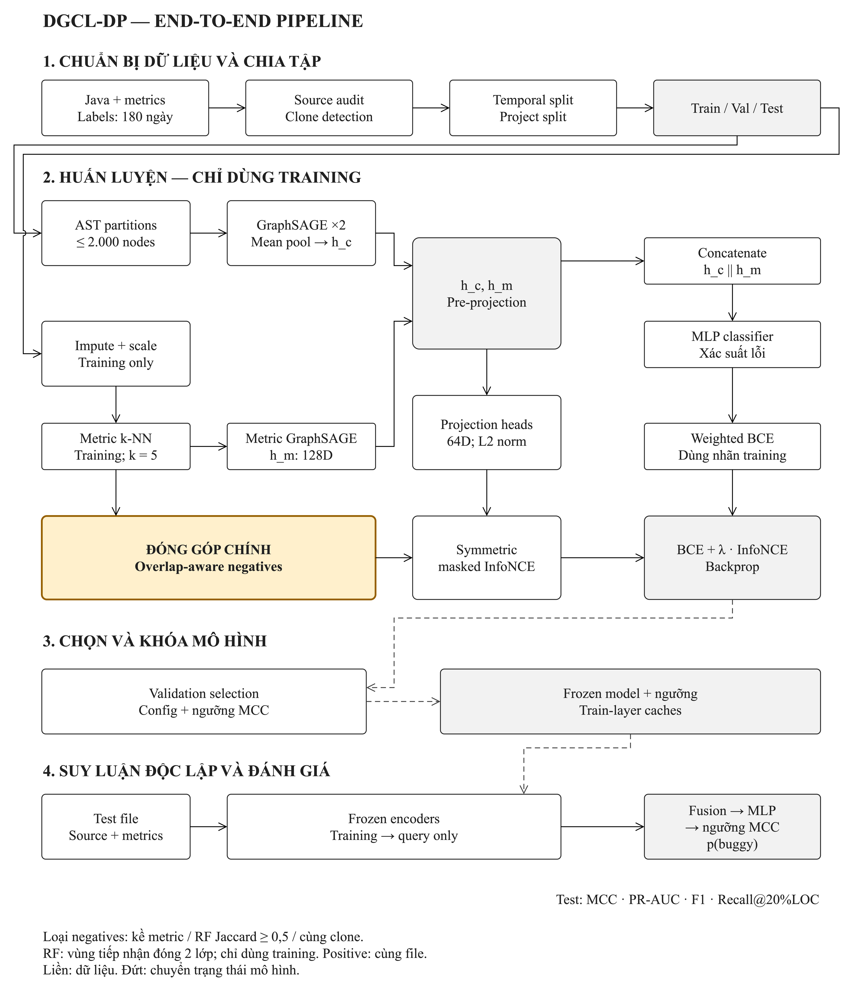

# DGCL-DP — hướng dẫn chạy nhanh

Dự đoán lỗi mã Java bằng đồ thị cú pháp và đồ thị độ đo phần mềm.
Yêu cầu **Python 3.11.11**; `uv` sẽ tự quản lý môi trường riêng.
Demo tự tạo dữ liệu giả để kiểm tra chương trình, **không phải kết quả nghiên cứu**.

## Pipeline đề xuất



[Tải PNG 300 dpi](paper/figures/dgcl-pipeline.png) hoặc
[mở bản chỉnh sửa bằng draw.io](paper/figures/dgcl-pipeline.drawio).
Khối tô vàng thể hiện đóng góp đề xuất: chọn mẫu âm có xét chồng lấn vùng tiếp nhận.

## Google Colab / Kaggle

Tạo notebook mới. Với Kaggle, bật **Settings → Internet**. Demo chạy được bằng CPU.
Chạy ô sau; môi trường Python 3.11 được tạo riêng, không cần đổi kernel notebook:

```python
%pip install -q uv
import os
os.environ["PYTHONHASHSEED"] = "0"
os.chdir("/kaggle/working" if os.path.isdir("/kaggle/working") else "/content")

!git clone https://github.com/dtknganvku/SDP-datasets.git
%cd SDP-datasets/dgcl-dp
!uv python install 3.11.11
!uv sync --frozen
!uv run python -m dgcl_dp.reproduce experiment=demo
```

Đọc bảng kết quả và tải toàn bộ kết quả về trước khi kết thúc phiên:

```python
import pandas as pd
import shutil
display(pd.read_csv("artifacts/demo/run/table3.csv"))
shutil.make_archive("ket-qua-dgcl", "zip", "artifacts/demo/run")
from IPython.display import FileLink, display
display(FileLink("ket-qua-dgcl.zip"))  # Kaggle: cũng có thể tải trong mục Output
```

Colab có thể tải trực tiếp bằng `from google.colab import files; files.download("ket-qua-dgcl.zip")`.
Nếu đã bật GPU trong cài đặt notebook, thử một lượt riêng:

```python
!uv run python -m dgcl_dp.reproduce experiment=demo model.device=cuda output=artifacts/demo-gpu
```

GPU chưa được kiểm chứng trên Colab/Kaggle. Nếu gặp lỗi CUDA hoặc phép toán
không hỗ trợ tính xác định, dùng lệnh CPU ở trên.

## Windows — PowerShell

Cài [Git for Windows](https://git-scm.com/downloads/win) và
[Python 3.11](https://www.python.org/downloads/windows/), rồi mở PowerShell mới:

```powershell
git clone https://github.com/dtknganvku/SDP-datasets.git
cd SDP-datasets\dgcl-dp
py -m pip install uv
py -m uv python install 3.11.11
py -m uv sync --frozen
$env:PYTHONHASHSEED = "0"
py -m uv run python -m dgcl_dp.reproduce experiment=demo
```

Không cần kích hoạt `.venv`. Kết quả nằm tại `artifacts\demo\run\table3.csv`.
Để tạo lại bảng từ dự đoán đã lưu, không huấn luyện lại:

```powershell
py -m uv run python -m dgcl_dp.reproduce experiment=demo mode=from_predictions
```

## Lệnh hữu ích

Chạy từ thư mục `dgcl-dp/` (Windows: thay `uv` bằng `py -m uv`):

```bash
uv run pytest -q
uv run python -m dgcl_dp.audit --archives ..
uv run python -m dgcl_dp.readiness
uv run python -m dgcl_dp.reproduce experiment=demo output=artifacts/lan-2
```

Mỗi lần huấn luyện mới cần `output` khác vì kết quả đã khóa không được ghi đè.
Muốn dùng mô hình pretrained hoặc MLflow: `uv sync --frozen --all-extras`.
Chạy lệnh kiểm toán với `--archives ..` sẽ kiểm tra bảy ZIP ở thư mục gốc repo.

## Dữ liệu thật

Các ZIP hiện chỉ được kiểm toán; chưa có bộ dữ liệu thật đủ điều kiện để chạy
nghiên cứu chính. Cần chuẩn bị manifest theo [hợp đồng dữ liệu](docs/data-contract.md),
rồi chạy `uv run python -m dgcl_dp.reproduce experiment=table3`.
Xem [hướng dẫn kỹ thuật](docs/technical-guide.md),
[tiến độ triển khai](docs/implementation-status.md) và [kiểm chứng cục bộ](docs/validation.md).
