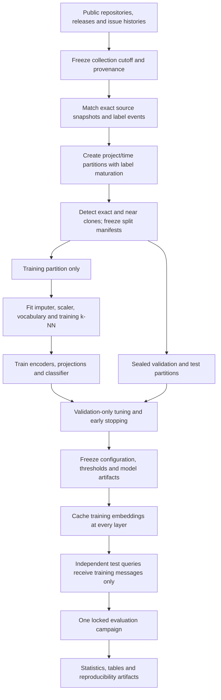

# DGCL-DP: Research Critique and Journal Experimental Plan

## 1. Assessment of the proposal

**Recommendation:** retain the AST–metric-graph architecture as the starting point, but make its added value a hypothesis to test. The current proposal is an implementation specification, not yet a journal contribution. Recent work already combines code representations, software metrics, graph learning and contrastive objectives.

The study will prioritize **Java file/class prediction**, cross-version and cross-project evaluation, and a **JSS/IST submission**. Multiple GPUs can support the experiments. JIT-DP remains related work rather than a second experimental task.

**Evidence status.** I read all seven pages of the supplied proposal and used Firecrawl to search and inspect publisher pages, arXiv, Semantic Scholar and GitHub. Context7 documentation was retrieved through `ctx7`. This is a verified scoping review, not a completed systematic literature review: inaccessible experimental details are explicitly marked **unverified**. Searches were conducted on **13 November 2026**. Papers with Code’s defect-detection URL redirected to a general papers feed, so it provided no reliable benchmark evidence.

Source proposal: :codex-file-citation{path="/Users/dkduy/VKU/Co_Ngan/DGCL-DP Đề xuất triển khai (Dual-Graph Contrastive Learning cho dự đoán lỗi phần.pdf" purpose="source"}

### What the PDF actually proposes

| Component | Proposal’s specification |
|---|---|
| Problem | Binary prediction of buggy/clean files or classes (*dự đoán file/class có lỗi*); `bug > 0` becomes positive. |
| Graph 1 | One AST graph per file; parent–child edges, optionally next-sibling edges. The introduction also mentions CFG, but the implementation specifies AST. |
| Graph 2 | A graph whose nodes are files/classes, connected by Euclidean k-NN similarity between standardized CK metrics. |
| Encoders | Separate 2–3-layer GCN or GraphSAGE encoders; hidden dimension 128, dropout 0.3. Code graphs use mean or attention pooling. |
| Contrastive objective | Symmetric InfoNCE: same-file code/metric representations are positives; other batch samples are negatives. Alternative SupCon: same-label samples are additional positives. |
| Classification | Concatenation, optionally gated fusion, followed by a two-layer MLP. Classification uses representations before the projection heads. |
| Loss | \(L=L_{\mathrm{cls}}+\lambda L_{\mathrm{contrastive}}\), with weighted BCE or focal loss. |
| Data | PROMISE Java metrics plus matching source releases; no exact benchmark manifest. |
| Evaluation | Older releases → newer releases; cross-project transfer; optional stratified tenfold comparison. F1, MCC, AUC; at least ten seeds. |
| Baselines | LR, RF, metric MLP, AST-only GCN, dual branch without contrastive learning, optionally CodeBERT. |
| Intended contributions | Two complementary views, contrastive alignment, an inductive metric graph and a reproducible pipeline. **The PDF does not formulate or substantiate explicit scientific novelty claims.** |

### Ambiguities and weaknesses requiring explicit resolution

| Issue | Consequence | Decision for this study |
|---|---|---|
| File versus class labels | A class metric vector may be paired with the AST of several classes. | Main cohort uses production Java files containing one top-level class; nested classes remain inside it. Report exclusions. Multi-class files receive a separate sensitivity analysis only. |
| AST versus CFG | These capture different information and require different tooling. | AST first. CFG/PDG are related-work comparators, not silently substituted into DGCL-DP. |
| “Independent views” | CK metrics are largely derived from the same source code; independence is not established. | Call them complementary representations, and measure redundancy and incremental utility. |
| k-NN similarity | Similar metric vectors do not necessarily imply shared defect mechanisms or label homophily. | Compare against metric MLP, neighbour averaging, shuffled neighbours and distance-matched random graphs. |
| Test-node attachment | Undirected query edges can change training embeddings or permit query interaction through shared training nodes. | Freeze layer-wise training representations and evaluate each query through incoming training messages only. |
| SupCon positives | Two buggy classes may have unrelated defect mechanisms; noisy labels can amplify incorrect attraction. | Keep instance alignment primary; evaluate SupCon as a controlled alternative. |
| Graph augmentation | Dropping AST edges can remove the evidence needed to predict a defect. | Treat augmentation as representation corruption, not a guaranteed semantics-preserving transformation. |
| First 500 AST nodes | Can systematically discard later methods and disadvantage larger files. | Use deterministic method-aware graph partitioning; test the PDF’s 500-node truncation separately. |
| Optional CodeBERT | Too weak a baseline commitment given current literature. | Pretrained-model comparisons become mandatory. |
| Random tenfold evaluation | Does not establish future-release performance. | Exclude from confirmatory evaluation. |
| Five-week schedule | Omits substantial provenance, baseline and statistical work. | Replace with the 16-week schedule below. |

### Findings from the actual workspace

The seven local archives contain **18 CSVs and 7,749 rows with parseable defect counts**, before source matching, deduplication or quality filtering.

Material problems found:

- `poi-3.0.csv` is packaged under a source directory labelled POI 3.13.
- Other source-directory versions also differ from CSV release names.
- Ant 1.5/1.6 CSVs contain merged schemas, duplicate column names and many rows without defect labels. Missing labels must never become clean labels.
- Xalan 2.7 contains **897 positive labels among 898 rows**; jEdit 4.3 contains **11 positives among 492 rows**.
- A filename match somewhere in an archive does not establish a match to the correct release.

**Decision:** use these archives for provenance auditing and pilot replication. They are not yet an approved confirmatory benchmark.

---

## 2. Literature review and research gaps

### Verified research matrix

“Unverified” means that the relevant detail was not established from the accessible source. A risk entry identifies something to audit; it does not assert that the authors committed leakage.

| Paper | Year/Venue | Graph type | Learning paradigm | Dataset | Split protocol | Metrics verified | Leakage risk / audit requirement | Limitations for DGCL-DP |
|---|---|---|---|---|---|---|---|---|
| Cui et al., *Research of Software Defect Prediction Model Based on Complex Network and Graph Neural Network* [R1] | 2022, Entropy | Inter-class dependency graph; community subgraphs | Supervised GCN/GIN variants | Six PROMISE projects | Random tenfold; 90/10 | Accuracy, F-measure, MCC | Full-graph construction and preprocessing order require scrutiny; unsuitable evidence for temporal generalization | Dependency edges are more program-grounded than metric k-NN; useful structural comparator |
| Cheng et al., *Path-Sensitive Code Embedding via Contrastive Learning…* / ContraFlow [R2] | 2022, ISSTA | Value-flow/program-dependence paths | Self-supervised contrastive pretraining | 288 real-world projects | Unverified | F1, informedness, markedness; localization measures | Repository/clone separation and pretraining scope unverified | Vulnerability detection, not release-level defect prediction |
| Guo et al., *UniXcoder* [R3] | 2022, ACL | AST incorporated through structured sequences | Cross-modal pretraining, including contrastive learning | Nine code-task datasets | Task-specific; DP protocol not applicable | Task-specific | External pretraining overlap with evaluation code | Representation baseline, not a ready-made release-DP system |
| Xia et al., *ProGCL* [R4] | 2022, ICML | General attributed graphs | Contrastive learning with negative reweighting/mixing | General graph benchmarks | DP transfer protocol unverified | Node-classification evaluation | Must rebuild all negative estimation from training data | Already studies message passing and false negatives; prevents claiming that problem as new |
| Hou et al., *GraphMAE* [R5] | 2022, KDD | General attributed graphs | Masked feature reconstruction | 21 graph datasets | Task-specific | Task-specific | DP adaptation must avoid transductive test access | Important non-contrastive SSL control |
| Liu et al., *ContraBERT* [R6] | 2023, ICSE | Code/text representations | Contrastive enhancement of code models | Exact benchmark details unverified | Unverified | Unverified | Augmentation validity and pretraining overlap | Generic contrastive robustness already studied |
| Khleel & Nehéz, *CNN and GRU based on SMOTE Tomek* [R7] | 2023, JIIS | None | Supervised deep learning plus resampling | PROMISE | WPDP; exact partition protocol unverified | Full metric list unverified | Verify resampling occurs after splitting and inside training folds | Synthetic metric samples have no corresponding real AST |
| Sahar et al., *DP-CCL* [R8] | 2024, IEEE Access | No separate metric graph verified | Supervised contrastive CodeBERT; metrics fusion; LR | Ten PROMISE projects | Unverified | F-score; MCC reported in accessible material | Source-release matching, duplicates and training scope unverified | **Direct precedent for contrastive code–metric fusion** |
| Han et al., *bjCnet* [R9] | 2024, Computers & Security | No graph requirement verified | Supervised contrastive pretrained code model; retrieval | Method-level; exact corpus unverified | Unverified | Accuracy, F1 | Retrieval candidate pool and duplicate control require audit | Linked GitHub main branch exposed only a README when inspected |
| Keshavarz & Rodríguez-Pérez, *JITGNN* [R10] | 2024, JSS | Changed-program ASTs | Supervised GNN plus change metadata | OpenStack, ApacheJIT | Chronological; Apache training 2003–2016, test sampled from 2017–2019 | AUC, precision, recall, F1 | Label availability and clone control remain separate questions from chronology | Reports comparable AUC to JITLine; graph complexity does not guarantee gains |
| Ju et al., *JIT-CF* [R11] | 2025, IST | No explicit graph verified | Contrastive CodeBERT plus expert-feature fusion | JIT-Defects4J | Unverified | F1, AUC, Recall@20%E, Popt | Cutoffs, negatives and duplicates require audit | Already combines contrastive learning and feature fusion; accessible page reports conflicting dataset counts |
| Shahini et al., *On the Calibration of JIT Defect Prediction* [R12] | 2025, MSR | None required | Calibration evaluation | Qt, OpenStack | Exact protocol unverified | ECE; other details unverified | Calibration data must be isolated from test | Post-calibration did not consistently help; calibration alone is weak novelty |
| Meng et al., *GLA-SDP* [R13] | 2026 issue, JSS; DOI dated 2025 | AST parent–child/sibling graph | GCN + metric LSTM + attention fusion | Eight PROMISE Java projects; Devign also reported | Exact protocol unverified | F1, MCC | Temporal and source alignment details require full-text audit | **Close architectural comparator for AST–metric fusion** |
| Tao et al., *Software Defect Prediction Based on Graph Code Semantics* [R14] | 2026 issue, ESWA; DOI dated 2025 | CFG/PDG via improved TinyPDG | CBOW, attention/BiLSTM, metric fusion, SMOTETomek | Seven PROMISE projects | Unverified | AUC, F1, accuracy | Corpus fitting and resampling order require audit | Demonstrates that richer graph semantics and metric fusion already exist |
| Liu & Jin, *DP-GCN* [R15] | 2026, JSEP | GCN/global code dependencies; precise construction unverified | GraphCodeBERT + GCN + contrastive learning + metrics | Ten PROMISE projects | Within-/cross-project; exact partitioning unverified | Unverified | Full graph construction, preprocessing and split isolation need inspection | **Closest integration-level competitor** |
| Nam et al., *ReDef* [R16] | 2025 arXiv; 2026 PACMSE/FSE record | None required | Code-model evaluation with counterfactual probes | 22 C/C++ projects; 13,432 modifications | Per-project chronological 80/10/10 | Full metric definitions unverified here | Revert-label selection, clone separation and label-availability audit remain relevant | Strong model-understanding diagnostic; different language, unit and label mechanism |

Two methodological anchors are especially relevant:

- **Herbold et al. (2022)** document problems in SZZ-derived labels and feature collection; a released CSV should not be treated as ground truth without qualification ([DOI](https://doi.org/10.1007/s10664-021-10092-4)).
- **ProGCL already explains why similarity-based hard-negative mining can fail after graph message passing**. Any DGCL-DP sampling contribution must distinguish itself experimentally from that work, not merely rename it (Xia et al., 2022, [source](https://proceedings.mlr.press/v162/xia22b.html)).

AST, CFG/PDG and inter-class dependency representations are covered above. **A metric-similarity edge must not be described as a call or dependency edge.** CPG-based vulnerability research is relevant background, but it does not establish effectiveness on the proposed file/class task.

### Five concrete gaps worth testing

| Gap | Evidence and qualification | DGCL-DP opportunity |
|---|---|---|
| G1. Uncertain incremental value of the metric graph | Close methods already fuse semantic and handcrafted information; JITGNN also provides evidence that graphs need not improve discrimination | Isolate graph utility from metric features, model capacity and fusion |
| G2. Cross-view negatives can share graph context | ProGCL establishes the general message-passing problem; the AST-graph-to-metric-node setting creates a specific cross-granularity case | Test whether metric receptive-field overlap harms instance alignment |
| G3. Temporal order does not ensure label availability | SZZ quality concerns and missing label timestamps in legacy CSVs | Evaluate with explicit label-maturation windows and deployment cutoffs |
| G4. Reported gains may depend on evaluation conditions | Several close competitors’ accessible sources do not establish clone-disjoint temporal protocols | Reproduce close methods under one audited protocol; do not assume their original results are leaky |
| G5. Representation gains may not improve inspection utility | F1/AUC dominate accessible claims; calibration and graph-complexity findings are mixed | Measure effort-aware utility, calibration, extraction failures and total cost |

**Novelty boundary:** these are research opportunities, not verified claims that no previous paper addresses them. Complete backward/forward citation screening before writing any “first” claim.

---

## 3. Candidate contributions and recommended method

### Ranked improvements

| Rank / option | Hypothesis and design | Expected benefit | Cost | Decisive ablation | Novelty / feasibility / publishability |
|---|---|---|---|---|---|---|
| **1. Graph-overlap-aware cross-view negatives** | Metric message passing makes some different-file representations share substantial context. Exclude those pairs from instance-level negatives using training-graph receptive fields; never turn them into positives automatically | Reduce contradictory alignment pressure without trusting noisy defect labels | Low–moderate; receptive-field bookkeeping and effective-negative monitoring | Ordinary InfoNCE; equal-count random masking; clone-only masking; ProGCL-style weighting; overlap-aware masking | Moderate and **conditional** / high / credible if mechanism and practical gains hold |
| **2. Source-support-aware metric fusion** | Distant target files have unreliable source neighbours. Add a metric-MLP residual and attenuate graph contribution using training-reference distances | Better cross-project behaviour when metric neighbourhoods are unsupported | Moderate | No gate, constant gate, learned gate, distance gate, metric MLP alone | Moderate application novelty / high / useful robustness extension |
| **3. Class-balanced SupCon hybrid** | Majority anchors dominate representation learning, but binary same-label attraction can amplify noise. Balance anchor contributions and compare instance versus supervised positives | Better minority-class retrieval and potentially MCC | Moderate; extra sampling/loss analysis | BCE only; BCE+InfoNCE; BCE+SupCon; balanced versus ordinary anchors; noise stress | Low–moderate / high / insufficient as the sole contribution |

**Primary recommendation:** Option 1, on the original two-encoder architecture. Keep Options 2–3 separate experiments; do not combine all three into an unexplained larger model.

ProGCL makes the novelty burden substantial. The intended contribution is specifically **cross-view alignment between per-file code graphs and nodes of a shared metric graph**, with a controlled mechanism study. If it merely reproduces generic negative rejection, narrow the claim accordingly.

### Frozen primary specification

**Code branch**

- Parse Java using tree-sitter; document that it produces a concrete syntax tree and specify the named-node transformation used as the AST approximation.
- Preserve node types, identifier/literal categories, child order and forward/reverse parent–child edges.
- Use two GraphSAGE layers, hidden dimension 128, mean pooling and dropout 0.3.
- For large files, partition deterministically at method boundaries into subgraphs of at most 2,000 named nodes; pool subgraphs to one file representation. Record every partition and any oversized-method truncation.

**Metric branch**

- Use an explicitly documented metric schema; never merge similarly named metrics from different extractors without checking definitions.
- Fit missing-value imputation, constant-feature removal and z-score scaling on training data.
- Construct a symmetric training-only k-NN graph, default \(k=5\).
- Encode with two GraphSAGE layers, hidden dimension 128. Compute the complete training metric graph during training; code graphs remain minibatched.

**Alignment and classification**

- Two-layer projection heads produce normalized 64-dimensional vectors.
- The positive is exclusively the code/metric pair for the same sample.
- For each training node, compute its closed two-layer receptive field. Mask a candidate negative if it is a direct metric neighbour, has receptive-field Jaccard overlap ≥0.5, or belongs to the same detected clone family.
- Masking uses training structure and fingerprints only; no validation/test labels or embeddings.
- Preserve the positive in every denominator. Skip contrastive loss for anchors with no eligible negatives, while retaining classification loss; log the skipped fraction.
- Concatenate the pre-projection representations and use a two-layer binary classifier.
- Primary loss:

\[
L=L_{\mathrm{weighted\ BCE}}
+\lambda\frac{L_{c\rightarrow m}^{\mathrm{masked}}
+L_{m\rightarrow c}^{\mathrm{masked}}}{2}.
\]

- Use naturally shuffled, unique samples per batch. Do not combine balanced resampling and inverse-frequency BCE weighting by default.
- Default batch size 64; Adam, learning rate \(10^{-3}\), weight decay \(10^{-4}\); maximum 200 epochs.

**Inference contract**

Cache training-node representations at every layer in evaluation mode. A validation/test query receives messages from training neighbours and its own previous-layer state. It never updates training nodes, receives messages from other queries, or alters normalization statistics.

**Novelty go/no-go, using development data only**

Continue Option 1 as the primary method only if its improvement survives:

1. Equal-count random negative masking.
2. ProGCL-style weighting under the same training scope.
3. Metric-MLP replacement and capacity-matched fusion.
4. Minority-class and effective-negative-count diagnostics.

A null result supports a narrower empirical paper. It must not trigger test-driven invention of additional components.

---

## 4. Experimental design

### Datasets and admission rules

| Dataset/cohort | Size established here | Labels and quality concerns | Licence status | Planned role |
|---|---|---|---|---|
| Local PROMISE-style archives | Seven projects, 18 CSVs, 7,749 parseable labelled rows | Defect counts; original collection/cutoff unverified; source-version problems described above | Source licences differ; metric redistribution rights unverified | Audit and pilot replication |
| Public JIRA release benchmark [D1] | Inspected 22 release CSVs across ActiveMQ, Camel, Derby, HBase, Hive and Lucene | Contains `HeuBug` and `RealBug` labels; release-aware provenance must be traced to original collection | Mirror metadata says `other-open`; not a blanket redistribution licence | External historical replication using documented `RealBug` semantics |
| **Timestamped release cohort** | Target eight projects; final count measured after audit | Public releases, linked confirmed fixes, explicit 180-day outcome window; SZZ-derived attribution remains noisy | Verify each source licence and issue-data terms; release manifests/scripts when raw redistribution is restricted | **Primary deployment-oriented evaluation** |
| AEEEM | Five projects, 5,371 rows; counts checked against public mirror | Historical class labels; source-release linkage and label availability unverified | Dataset-specific terms unverified | Supplemental only if matching source and provenance pass |
| ReLink | Three canonical projects; commonly reported 649 instances, exact selected artifact unverified | Recovered issue/change links; not equivalent to perfect labels | Unverified | Supplemental candidate; no main dual-graph results without exact source |
| NASA/MDP cleaned | Depends on cleaning variant; no version selected | Known quality concerns; generally lacks the source mapping needed here | Artifact-specific; unverified | Exclude from main dual-graph evaluation |
| Defects4J | Inspected repository reports 854 active bugs plus ten deprecated, across 17 projects | Reproducible bugs; paired fixed versions do not constitute representative clean samples | Framework MIT; underlying projects retain their licences | Diagnostic examples only, not a balanced DP benchmark |
| ApacheJIT [D2] | 106,674 commits; 28,239 inducing and 78,435 clean | PyDriller/blame-based attribution plus filtering; verification latency still matters | Dataset CC BY 4.0 verified on Zenodo | Related-work/JIT extension only |
| JIT-Defects4J | 21 projects; counts conflict across accessible sources, including 27,391 and 23,379 | Trace to the exact version and original label construction | Unverified | Related-work/JIT extension only |
| DeepJIT/CC2Vec sets | DeepJIT sources report Qt 25,150 and OpenStack 12,374 commits; variants exist | Original labels, filtering and pretraining scope need reconstruction | Unverified | Not mixed with file/class experiments |

**Primary cohort defaults**

- Candidate projects: ActiveMQ, Camel, Derby, HBase, Hive, Lucene, Wicket and Ant.
- Stable releases dated 2020–2025; select the last stable release in each half-year, without inspecting outcome labels.
- Freeze data collection at **2026-10-31**.
- Outcome: a sample implicated in a confirmed bug fix within 180 days after its release. “Clean” means no observed qualifying fix in that window, not proven defect-free.
- Use issue-linked confirmed fixes and a documented blame-based SZZ variant; record inducing/fixing hashes, ancestry checks, ignored changes and availability timestamps.
- Audit at least 100 positive links, stratified by project, with two researchers independently reviewing a subset. This is a planned human validation activity.
- Do not overwrite original benchmark labels with reconstructed labels. Analyze them as separate cohorts.

**Admission gate:** exact release/source identity, unambiguous sample mapping, parse and metric coverage ≥95%, and sufficient class support. Confirmatory tasks need at least 20 positive and 20 negative evaluation samples after filtering. Report every excluded task.

If fewer than six primary projects pass, stop the deployment-generalization claim and revise the study to historical empirical evaluation before accessing test results.

### RQ1–RQ5

| RQ | Question | Main evidence |
|---|---|---|
| RQ1 | Does DGCL-DP improve predictive and inspection utility over strong alternatives? | MCC primary; PR-AUC, F1 and effort-aware outcomes |
| RQ2 | Which graph, alignment, sampling and fusion components explain its behaviour? | Controlled ablations and matched-capacity comparisons |
| RQ3 | Does performance transfer across releases and projects? | Temporally valid cross-version and source-only cross-project protocols |
| RQ4 | How sensitive is it to label noise, imbalance, feature noise and graph corruption? | Fixed stress levels, no test-specific retuning |
| RQ5 | What does it cost, and are its explanations faithful? | Extraction/training/inference costs; attribution fidelity, stability and reviewed examples |

### Split protocols

**Cross-version:** newest eligible release is test; the latest preceding release whose complete 180-day label window ends before test deployment is validation. Training releases must have complete label windows before validation deployment.

**Cross-project:** hold out the entire target project. Tune on source projects through leave-one-source-project-out validation. At target deployment time, use only source examples whose labels were available by that date. No target fitting or unlabeled target adaptation.

Use the same immutable sample manifests for every model. Do not compare scores from different sample subsets without reporting that difference.

### Baselines

| Family | Required comparisons |
|---|---|
| Trivial/effort controls | Majority predictor; LOC-only model; inverse-LOC inspection ranking |
| Classical metrics | LR, RF, SVM, histogram gradient boosting, metric MLP |
| Historical deep | DBN on metrics; token CNN; token BiLSTM |
| Graph | AST-GCN, AST-GraphSAGE, AST-GAT/GGNN; metric graph alone |
| Fusion controls | AST + metric MLP; AST + metric graph without contrastive loss; parameter-matched concatenation/gating |
| Pretrained | CodeBERT, GraphCodeBERT, UniXcoder and CodeT5+ 220M; code-only and metric-fusion comparisons |
| Recent close methods | DP-CCL, GLA-SDP and DP-GCN where sufficient specification is obtainable |
| SSL/contrastive controls | Ordinary InfoNCE, SupCon, GraphCL-style corruption, GraphMAE adaptation and ProGCL-style weighting |

GraphCodeBERT must retain its intended data-flow input processing. Loading its weights as an ordinary token encoder is a separately labelled ablation.

DeepJIT, CC2Vec, JITGNN and JIT-CF belong to commit prediction. Do not present them as direct file-level replications.

If author code is absent, label the implementation a **paper-based reimplementation**; if essential details remain unavailable, label it an **adaptation**, not an exact reproduction.

### Tuning and training budget

- Same **20 completed trials per model per outer task**, using model-appropriate published search spaces.
- Search seed 10; re-evaluate the top three configurations with seeds 11 and 12. Select by their mean validation PR-AUC.
- Maximum 200 epochs; early stopping on validation PR-AUC, patience 20.
- Neural search: hidden size `{64,128,256}`, dropout `{0.1,0.3,0.5}`, learning rate `[10⁻⁴,3×10⁻³]`, weight decay `[10⁻⁶,10⁻³]`.
- DGCL-specific: \(k\in\{3,5,10,15\}\), \(\tau\in\{0.05,0.1,0.2,0.5\}\), \(\lambda\in\{0.1,0.5,1\}\). The zero-loss case is an explicit control.
- Run final selected configurations with **seeds 0–9**.
- Thresholds maximize validation MCC, with a deterministic tie rule; also report threshold 0.5.
- Parallelize independent studies across GPUs; keep each Optuna study sequential for reproducible trial proposals.
- Report both equal-trial comparisons and actual computational cost. Equal trials do not imply equal resource use.

### Metrics and statistical analysis

| Category | Specification |
|---|---|
| Classification | F1, MCC, ROC-AUC, balanced accuracy, G-mean; add PR-AUC because prevalence varies substantially |
| Effort-aware | Popt over the full inspection curve, Recall@20%LOC and IFA |
| Ranking | Primary effort ranking by predicted risk/LOC; probability-only ranking as sensitivity analysis |
| Effort definition | Source LOC available at prediction time; no future changed lines |
| Calibration | Brier score, ECE and reliability diagrams; calibration is evaluation, not a novelty claim |
| Variability | Per-task mean ± standard deviation over ten seeds, with seed-level 95% CIs |
| Generalization uncertainty | Project-cluster bootstrap CIs; preserve dependence between releases and seeds |

For effort metrics, use binary defective-file recall as the primary outcome, deterministic ties, and explicit handling of zero LOC and undefined cases. Fractional interpolation at the 20% budget boundary must be documented.

For confirmatory comparisons, aggregate seed results and dependent release tasks within project. Apply paired Wilcoxon tests across projects, **Holm correction**, and paired Vargha–Delaney \(A_{12}\). Report effect sizes and intervals even when significance is absent. Do not treat ten seeds as ten independent projects.

### Ablation and robustness matrix

| Component | Tests |
|---|---|
| Views | Code only; metric MLP only; metric graph only; both |
| Graph utility | True k-NN; neighbour averaging; shuffled edges; distance-matched random graph; no message passing |
| SSL | No pretraining; training-only contrastive pretraining; joint contrastive training; GraphMAE |
| Negatives | All; clone-only mask; graph-overlap mask; matched random mask; ProGCL-style weighting |
| Positives/loss | Instance InfoNCE; SupCon; balanced SupCon; weighted BCE versus focal |
| Augmentation | None; 10% feature masking; 10% optional-edge dropout; both; repeat at 20% as sensitivity |
| Fusion | Concatenation; gating; parameter-matched MLP |
| Code coverage | Method-aware partitioning versus first-500-node truncation |
| Label noise | Training-only random and class-conditional flips at 5%, 10%, 20%; SZZ-variant disagreement |
| Imbalance | Training prevalence stress at 1%, 5%, 10%, 20% where feasible; keep natural test prevalence |
| Structural noise | Metric noise and edge rewiring at fixed levels |
| Explanations | Gradient/perturbation attributions; comprehensiveness, sufficiency, seed stability and random-attribution controls |

Synthetic perturbations are diagnostics. They do not substitute for a clean-label benchmark or prove semantic preservation.

---

## 5. Mandatory leakage prevention

### Pipeline



### Checklist and automated assertions

- [ ] **Project/time separation:** no random commit-level splits; release dates and project identities are explicit.
- [ ] **Label availability:** every training label is available before the next deployment boundary. A negative label is available only after its observation window closes.
- [ ] **No retrospective upgrades:** fixes after a cutoff cannot retroactively modify the labels used by that training run.
- [ ] **Prediction-time features:** source and metrics come from the prediction snapshot; future fixes, post-fix files, later history and bug-report text are excluded from inputs.
- [ ] **Training-only pretraining:** contrastive/SSL training, augmentations, negative pools and mining indices contain training samples only.
- [ ] **External checkpoint disclosure:** published pretrained models are a separate external-data condition. Record training-corpus disclosures and acknowledge unresolved contamination.
- [ ] **Exact duplicates:** hash both raw source and comment/whitespace-normalized tokens.
- [ ] **Near duplicates:** fixed token-five-gram Jaccard ≥0.9 with length-ratio ≥0.8; thresholds are never selected from test performance.
- [ ] **Clone separation:** assign clone families to their earliest partition and remove later cross-partition members for the strict evaluation. Preserve an exclusion manifest and conflicting labels.
- [ ] **Estimand disclosure:** clone-disjoint evaluation measures generalization to different code; it can remove routine unchanged files. Report retention and the resulting population.
- [ ] **Training-only transforms:** imputation, scaling, feature selection, vocabularies and locally learned embeddings fit training data only.
- [ ] **Resampling:** apply only inside training folds. SMOTE belongs to metric-only controls; it cannot fabricate a paired real AST.
- [ ] **Inductive graph isolation:** training graph contains no validation/test nodes; query messages cannot flow back into training representations.
- [ ] **Model selection:** validation only; no test-driven thresholds, epochs, augmentations or method revisions.
- [ ] **Locked test campaign:** freeze all model configurations and ten-seed runs before evaluation. Reusing cached predictions for statistics is allowed.
- [ ] **Audit trail:** hash raw artifacts, split manifests, preprocessing state, checkpoints and prediction files.

Required automated tests:

1. Sample, project and clone-family disjointness.
2. Source timestamps and label-availability inequalities.
3. Neighbour IDs restricted to the appropriate training manifest.
4. Negative pools restricted to training.
5. Changing a test label leaves every fitted artifact unchanged.
6. Adding, removing or permuting unrelated test queries leaves an existing query prediction unchanged.
7. Training-node caches remain identical before and after query inference.
8. Unknown tokens, missing metrics, parse failures and single-class partitions follow documented behaviour.

---

## 6. Reproducibility package

### Repository and interfaces

```text
dgcl-dp/
  configs/       # data, split, model, training, search, evaluation
  src/dgcl_dp/   # acquisition, provenance, graphs, models, experiments
  tests/         # leakage, inference isolation, metrics, reproducibility
  manifests/     # immutable sample, label-event and split records
  artifacts/     # predictions, checkpoints, environment and run metadata
  paper/         # generated tables, figures and manuscript
```

The essential interfaces are:

- **Sample manifest:** stable sample ID, project, release/commit, source hash, prediction timestamp, unit, LOC and extraction status.
- **Label-event manifest:** label mechanism, fixing/inducing references, observation window and label-availability timestamp.
- **Split manifest:** sample IDs, clone groups, cutoff policy and checksum.
- **Prediction output:** sample ID, model/config hash, seed, probability, threshold, prediction, effort and runtime.

Keep outcome/provenance fields outside model feature loaders.

### Proposed exact environment pins

These versions exist in the package registry. API documentation was inspected through Context7 for the selected stack. **A combined environment has not been installed or compatibility-tested in this planning turn.**

| Component | Proposed pin |
|---|---|
| Python | 3.11.11 |
| PyTorch / PyG | 2.5.1 / 2.6.1 |
| NumPy / SciPy / pandas | 1.26.4 / 1.15.3 / 2.2.3 |
| scikit-learn | 1.7.1 |
| Transformers | 4.51.3 |
| Optuna | 4.5.0 |
| MLflow | 2.22.1 |
| Hydra | 1.3.2 |
| tree-sitter / Java grammar | 0.25.2 / 0.23.5 |
| PyDriller | 2.9 |
| CK metric extractor | Source commit `8a1ef916d597d33ad619d748b616bb7dbc3f0c36`; build and archive the resulting JAR hash |

Context7 returned an unrelated project for “CK”; its API was therefore not treated as documentation for the Java metric extractor. The official repository was inspected instead.

Implementation requirements:

- Hash-lock all transitive packages and the Docker base image after the compatibility smoke test.
- Pin tokenizer and pretrained checkpoint **commit revisions**, not mutable branch names.
- Use PyG’s current loader namespace and the capsule-based tree-sitter language/parser constructor.
- Keep Hydra on 1.3 with explicit `version_base="1.3"`; avoid mixing its configuration with development 1.4 documentation.
- Seed Python, NumPy, PyTorch, data-loader workers and Optuna.
- Enable deterministic algorithms, disable cuDNN benchmarking, and record any unsupported graph operation. Do not silently relax determinism.
- Guarantee reproducibility within the documented hardware/software environment; do not promise bitwise equality across GPU architectures.

The README must provide commands such as:

```bash
python -m dgcl_dp.reproduce experiment=table3
python -m dgcl_dp.reproduce experiment=table3 mode=from_predictions
python -m dgcl_dp.audit manifest=primary
```

The first reproduces training and evaluation; the second regenerates tables from released predictions.

Release:

- Download scripts, preprocessing scripts and immutable splits.
- Ten-seed checkpoints where redistribution permits.
- Raw per-sample predictions and failed-run records.
- Hydra resolved configs and MLflow exports.
- Model card, dataset cards, licence inventory and limitations.
- Hardware/runtime table: GPU, CPU, RAM, peak VRAM, extraction time, training time, inference latency, throughput and storage.
- Versioned Zenodo archive with a real DOI obtained at release time; no placeholder DOI presented as issued.
- A clean-container reproduction on a second machine before submission.

---

## 7. Journal and manuscript plan

### Target

| Journal | Fit and decision | Verified constraints |
|---|---|---|
| **JSS — primary** | Appropriate for a focused method plus rigorous SE evaluation; Open Science initiative fits the artifact contribution | Single-anonymized review; abstract ≤250 words. No general regular-article page cap established from the inspected guide |
| **IST — alternative** | Particularly suitable if the paper emphasizes practical inspection utility and evaluation methodology | Research paper ≤15,000 words, including references/appendices; each figure/table counts as 200 words. Structured abstract required: Context, Objectives, Methods, Results, Conclusion |

Use an internal target of roughly 9,000–11,000 prose words, leaving room for references and display items if submitting to IST. Recheck the official guides at submission.

EMSE becomes a stronger fit if the central result concerns evaluation artefacts or limited graph utility. TSE/TOSEM would require a stronger conceptual contribution and broader evidence than the current proposal establishes.

### Manuscript outline

| Section | Planned content |
|---|---|
| Abstract | Problem, specific hypothesis, audited protocol, measured results and bounded conclusion |
| Introduction | Practical inspection setting; why graph utility is uncertain; precise contributions |
| Background | File/class DP, AST and metric graphs, contrastive learning, label maturation |
| Related Work | Graph representations; code/graph SSL; fusion; transfer; imbalance; pretrained models |
| Approach | Formal sample/view definitions, graph construction, masked objective and inductive inference |
| Experimental Setup | Cohorts, provenance, splits, baselines, equal-budget tuning, metrics and preregistered analysis |
| Results | RQ1–RQ5, including null results and costs |
| Discussion | When graph context helps, failure mechanisms and deployment implications |
| Threats to Validity | Internal, external, construct and conclusion threats |
| Conclusion | Supported findings and remaining limits |
| Data Availability | Artifact version, licences, access instructions and issued DOI |

**Provisional contribution list—retain only after validation:**

1. A precisely specified inductive AST–metric-graph prediction framework.
2. A tested account of how shared metric-graph context affects cross-view negative sampling.
3. Evidence across temporally valid and cross-project tasks against strong fusion and pretrained baselines.
4. A provenance-aware, reproducible evaluation package.

The first and fourth are enabling contributions; they cannot alone substantiate algorithmic novelty.

### Planned tables and figures

| Artifact | Caption/purpose |
|---|---|
| Table 1 | “Included datasets, source coverage, label availability and exclusions.” |
| Table 2 | “Baselines, available inputs and identical tuning budgets.” |
| Table 3 | “Cross-version and cross-project effectiveness with project-level uncertainty.” |
| Table 4 | “Ablations separating metric features, graph structure and contrastive sampling.” |
| Table 5 | “Robustness, effort-aware utility and computational cost.” |
| Figure 1 | “Leakage-controlled data and evaluation pipeline.” |
| Figure 2 | “Cross-view alignment and isolated query inference.” |
| Figure 3 | “Performance differences by project with confidence intervals.” |
| Figure 4 | “Negative overlap, masking rate and alignment behaviour.” |
| Figure 5 | “Inspection curves and attribution fidelity examples.” |

Do not use t-SNE/UMAP separation as evidence of predictive effectiveness.

### Likely reviewer objections

| Objection | Design response |
|---|---|
| “This combines existing components.” | Direct DP-CCL/DP-GCN/GLA-SDP comparisons; narrow mechanism claim; ProGCL control |
| “The second graph adds no meaningful relation.” | Metric MLP, neighbour averaging and shuffled/distance-matched graph controls |
| “Masking simply makes the objective easier.” | Equal-count random masking and effective-negative diagnostics |
| “Results reflect noisy or future-informed labels.” | Timestamped label windows, SZZ audit, alternative attribution and explicit historical-only claims |
| “Clone removal changes the task.” | Report retained population and distinguish novel-code generalization |
| “The sample size is inflated by seeds/releases.” | Project-level inference and dependence-aware uncertainty |
| “Pretrained models saw the benchmark.” | Checkpoint provenance; recent held-out releases; unresolved exposure stated explicitly |
| “Explanations are decorative.” | Perturbation fidelity and random-attribution controls; no causal claims |
| “Extraction failures favour the proposed method.” | Common evaluation manifests, coverage reporting and failure-inclusive sensitivity analysis |
| “Costs exceed the practical benefit.” | End-to-end cost, latency and effort-aware comparisons |

---

## 8. Sixteen-week schedule and decision gates

Compute figures are **planning estimates**, to be replaced by week-4 measurements. They are not authorization to purchase cloud resources.

| Weeks | Milestone | Estimated compute | Gate |
|---|---|---|---|
| 1–2 | Finish citation screening; audit local/public data; freeze sample unit, outcomes and split rules | 100–200 CPU-hours | Exact source matching and label provenance demonstrated; quarantine mismatches |
| 3–4 | Build timestamped cohort; parser/metric pipeline; leakage tests; classical and fusion pilots | 150–300 CPU-hours; 30–80 GPU-hours | ≥6 eligible primary projects; ≥95% extraction coverage; environment and inference isolation pass |
| 5–6 | Reproduce PDF baseline; AST/metric controls; implement overlap-aware negatives | 100–250 GPU-hours | Development-only mechanism gate against random masking and ProGCL |
| 7–9 | Equal-budget tuning of close methods, deep models and pretrained baselines | 800–2,000 GPU-hours | Reproduction deviations documented; all model/config decisions frozen |
| 10–11 | Ten-seed final runs and locked test campaign | 500–1,500 GPU-hours | No changes motivated by test outcomes |
| 12–13 | Prespecified robustness, efficiency, explanation and statistical analyses | 200–600 GPU-hours | Effects stable enough for the stated claim; no selective omission |
| 14 | Draft complete RQ-driven manuscript; second-machine reproduction | 50–150 GPU-hours | Tables regenerate from released predictions; representative training run reproduces |
| 15–16 | Critical internal review; licence audit; artifact archive; journal formatting | 20–50 GPU-hours | Claims match evidence; issued archive DOI and complete availability statement |

**Working envelope:** approximately **1,700–4,600 GPU-hours**, plus preprocessing and storage. Four GPUs permit parallel independent runs; they do not guarantee linear speedup. Plan 128 GB host RAM and approximately 1 TB working storage, then revise from measured requirements.

If the budget is insufficient, reduce optional supplemental datasets and optional extensions **before** reducing mandatory leakage checks, close-method controls or ten-seed reporting.

### Decisions and assumptions recorded

Your three clarifications are resolved: file/class prediction is primary, multiple GPUs/cloud are available, and JSS/IST is the first publication target.

Defaults requiring no further implementation choice:

- Java production code; single-top-level-class files for the primary cohort.
- PyTorch Geometric, not a parallel DGL implementation.
- AST plus metric k-NN; no unmotivated conversion to CPG.
- Training-only, label-independent overlap masking as the candidate method extension.
- Explicit 180-day outcomes and label availability for deployment-oriented claims.
- Legacy datasets remain historical evidence when timestamps cannot be reconstructed.
- Publication novelty remains conditional on the controls; no positive outcome is assumed.

### References

The links below identify verified titles and publication records. Experimental details marked unverified above still require full-text extraction.

- **[R1] Cui et al. (2022).** *Research of Software Defect Prediction Model Based on Complex Network and Graph Neural Network*. Entropy. [DOI: 10.3390/e24101373](https://doi.org/10.3390/e24101373).
- **[R2] Cheng et al. (2022).** *Path-Sensitive Code Embedding via Contrastive Learning for Software Vulnerability Detection*. ISSTA. [DOI: 10.1145/3533767.3534371](https://doi.org/10.1145/3533767.3534371).
- **[R3] Guo et al. (2022).** *UniXcoder: Unified Cross-Modal Pre-training for Code Representation*. ACL. [DOI: 10.18653/v1/2022.acl-long.499](https://doi.org/10.18653/v1/2022.acl-long.499).
- **[R4] Xia et al. (2022).** *ProGCL: Rethinking Hard Negative Mining in Graph Contrastive Learning*. ICML, PMLR 162. [Proceedings](https://proceedings.mlr.press/v162/xia22b.html); DOI not verified. [Code](https://github.com/junxia97/ProGCL).
- **[R5] Hou et al. (2022).** *GraphMAE: Self-Supervised Masked Graph Autoencoders*. KDD. [DOI: 10.1145/3534678.3539321](https://doi.org/10.1145/3534678.3539321). [Code](https://github.com/THUDM/GraphMAE).
- **[R6] Liu et al. (2023).** *ContraBERT: Enhancing Code Pre-Trained Models via Contrastive Learning*. ICSE. [DOI: 10.1109/ICSE48619.2023.00207](https://doi.org/10.1109/ICSE48619.2023.00207).
- **[R7] Khleel & Nehéz (2023).** *A Novel Approach for Software Defect Prediction Using CNN and GRU Based on SMOTE Tomek Method*. Journal of Intelligent Information Systems. [DOI: 10.1007/s10844-023-00793-1](https://doi.org/10.1007/s10844-023-00793-1).
- **[R8] Sahar et al. (2024).** *DP-CCL: A Supervised Contrastive Learning Approach Using CodeBERT Model in Software Defect Prediction*. IEEE Access. [DOI: 10.1109/ACCESS.2024.3362896](https://doi.org/10.1109/ACCESS.2024.3362896).
- **[R9] Han et al. (2024).** *bjCnet: A Contrastive Learning-Based Framework for Software Defect Prediction*. Computers & Security. [DOI: 10.1016/j.cose.2024.104024](https://doi.org/10.1016/j.cose.2024.104024). [Repository inspected](https://github.com/das-lab/bjCnet).
- **[R10] Keshavarz & Rodríguez-Pérez (2024).** *JITGNN: A Deep Graph Neural Network Framework for Just-In-Time Bug Prediction*. JSS. [DOI: 10.1016/j.jss.2024.111984](https://doi.org/10.1016/j.jss.2024.111984).
- **[R11] Ju et al. (2025).** *JIT-CF: Integrating Contrastive Learning with Feature Fusion for Enhanced Just-in-Time Defect Prediction*. IST. [DOI: 10.1016/j.infsof.2025.107706](https://doi.org/10.1016/j.infsof.2025.107706).
- **[R12] Shahini, Bartel & Pohl (2025).** *On the Calibration of Just-in-Time Defect Prediction*. MSR. [DOI: 10.1109/MSR66628.2025.00018](https://doi.org/10.1109/MSR66628.2025.00018); [accessible preprint](https://arxiv.org/abs/2504.12051).
- **[R13] Meng et al. (2026 issue).** *GLA-SDP: A Novel Attention-Based Semantic and Static Feature Fusion Method Using GCN and LSTM for Software Defect Prediction*. JSS. [DOI: 10.1016/j.jss.2025.112630](https://doi.org/10.1016/j.jss.2025.112630).
- **[R14] Tao et al. (2026 issue).** *Software Defect Prediction Based on Graph Code Semantics*. ESWA. [DOI: 10.1016/j.eswa.2025.129842](https://doi.org/10.1016/j.eswa.2025.129842).
- **[R15] Liu & Jin (2026).** *DP-GCN: Integrating GraphCodeBERT and GCN With Contrastive Learning for Software Defect Prediction*. JSEP. [DOI: 10.1002/smr.70116](https://doi.org/10.1002/smr.70116).
- **[R16] Nam et al. (2025 preprint; 2026 publication record).** *ReDef: Do Code Language Models Truly Understand Code Changes for Just-in-Time Software Defect Prediction?* PACMSE/FSE record. [DOI: 10.1145/3808179](https://doi.org/10.1145/3808179); [version inspected](https://arxiv.org/html/2509.09192v2).
- **[R17] Herbold et al. (2022).** *Problems with SZZ and Features: An Empirical Study of the State of Practice of Defect Prediction Data Collection*. EMSE. [DOI: 10.1007/s10664-021-10092-4](https://doi.org/10.1007/s10664-021-10092-4).
- **[R18] Feng et al. (2020).** *CodeBERT: A Pre-Trained Model for Programming and Natural Languages*. Findings of EMNLP. [DOI: 10.18653/v1/2020.findings-emnlp.139](https://doi.org/10.18653/v1/2020.findings-emnlp.139).
- **[R19] Guo et al. (2021).** *GraphCodeBERT: Pre-training Code Representations with Data Flow*. ICLR. [Official record](https://openreview.net/forum?id=jLoC4ez43PZ); DOI not verified.
- **[R20] Wang et al. (2023).** *CodeT5+: Open Code Large Language Models for Code Understanding and Generation*. Version verified as arXiv preprint. [DOI: 10.48550/arXiv.2305.07922](https://doi.org/10.48550/arXiv.2305.07922).
- **[R21] You et al. (2020).** *Graph Contrastive Learning with Augmentations*. NeurIPS. [Verified preprint](https://arxiv.org/abs/2010.13902); [DOI record: 10.5555/3495724.3496212](https://dl.acm.org/doi/10.5555/3495724.3496212).
- **[D1] Large Defect Prediction Benchmark (2022 archive).** [DOI: 10.5281/zenodo.6342328](https://doi.org/10.5281/zenodo.6342328). Collection licence metadata does not establish uniform rights for constituent datasets.
- **[D2] Keshavarz et al. (2022).** *ApacheJIT: A Large Dataset for Just-In-Time Defect Prediction*. [Paper](https://arxiv.org/abs/2203.00101); [dataset DOI: 10.5281/zenodo.5907002](https://doi.org/10.5281/zenodo.5907002).
- **[D3] Defects4J maintainers.** [Repository and current dataset description](https://github.com/rjust/defects4j), accessed 2026-11-13.
- **[J1] JSS author guide.** [Official constraints and Open Science guidance](https://www.sciencedirect.com/journal/journal-of-systems-and-software/publish/guide-for-authors), accessed 2026-11-13.
- **[J2] IST author guide.** [Official format and length constraints](https://www.sciencedirect.com/journal/information-and-software-technology/publish/guide-for-authors), accessed 2026-11-13.

Documentation provenance: [PyTorch reproducibility](https://pytorch.org/docs/2.5/notes/randomness.html), [PyG](https://pytorch-geometric.readthedocs.io/en/2.6.1/), [scikit-learn leakage guidance](https://scikit-learn.org/1.7/common_pitfalls.html), [Optuna reproducibility](https://optuna.readthedocs.io/en/stable/faq.html), [MLflow](https://mlflow.org/docs/2.22.1/), [Hydra](https://hydra.cc/docs/1.3/intro/), [tree-sitter Java](https://github.com/tree-sitter/tree-sitter-java), [PyDriller](https://pydriller.readthedocs.io/en/latest/), [Transformers](https://huggingface.co/docs/transformers/v4.51.3/en/index), and [CK](https://github.com/mauricioaniche/ck). Documentation pages are software sources, not research-paper evidence.
